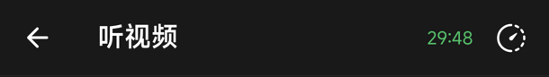
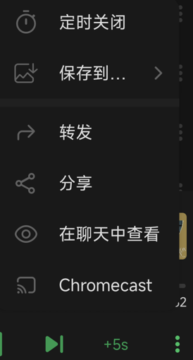
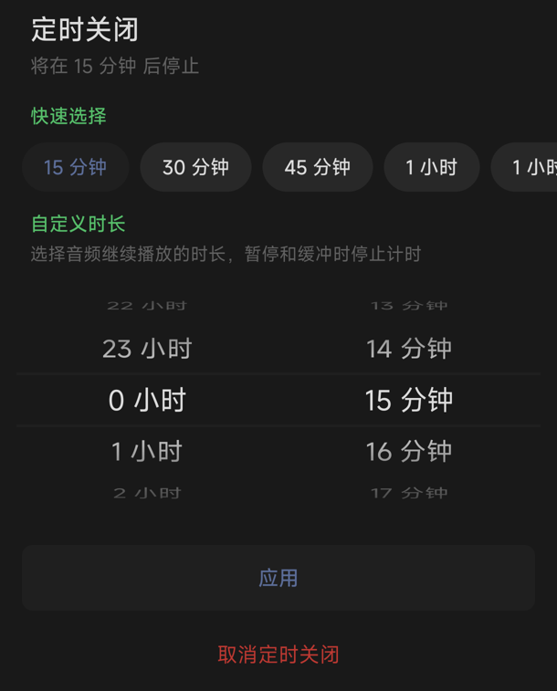

<div align="center">


# Nagram 定时播放

**给 NagramX 和 NiagramX 加上听视频、后台播放和定时关闭。**

[](#兼容范围)
[](#兼容范围)
[](#兼容范围)
[](LICENSE)

[](https://github.com/Xposed-Modules-Repo/com.shitianyaa.nagramx.videotimer/releases/latest)
[](https://github.com/Xposed-Modules-Repo/com.shitianyaa.nagramx.videotimer/releases)

</div>

---

## 安装

1. 从 [LSPosed 模块仓库](https://github.com/Xposed-Modules-Repo/com.shitianyaa.nagramx.videotimer/releases/latest) 下载 APK 并安装。
2. 在 LSPosed 中启用「Nagram 定时播放」，勾选正在使用的 NagramX 或 NiagramX。
3. 强制停止宿主应用，再重新打开。

安装后请到 LSPosed 管理模块。模块没有桌面入口，播放和定时都在 NagramX 或 NiagramX 里操作。

以下入口按 **1.3.0** 编写。用模块仓库正式包安装的用户，从 1.1.1 起可直接覆盖升级。1.0.0 至 1.1.0 的旧包需要先卸载。

## 功能入口

| 想做什么 | 在哪点 |
| --- | --- |
| 后台听视频 | 打开普通视频 → 设置菜单 → **听视频** |
| 给视频设定时 | 听视频页右上角的定时按钮 |
| 给音乐或音频文件设定时 | 开始播放 → 点顶部播放栏展开播放器 → 右下角 **⋮** → 第一项 **定时关闭** |
| 修改或取消定时 | 回到同一个定时入口。音频菜单会显示剩余时间，点进去可以改时长或取消 |

### 听视频

点「听视频」后会从当前进度继续播。这个页面可以调倍速、拖进度、切换上一条或下一条，右下角列表按钮能打开当前聊天的共享视频。按返回键离开页面后可以继续听，点聊天顶部播放栏就能回来。想接着看画面，点封面或「返回画面」。

点右上角的定时按钮，可以选时长，也可以选「当前视频播放结束后」。如果设的是时长，切换视频后会接着倒计时。宿主有内置视频定时时，听视频页会使用宿主的定时功能。

<p align="center"></p>

### 音乐与音频文件

展开音乐播放器，点右下角「⋮」的第一项「定时关闭」。点预设时长直接启用，或者调好小时和分钟后点「应用」。两个定时面板都提供 15、30、45、60、90 分钟，自定义范围为 1 分钟到 23 小时 59 分钟。小时选 0 时，分钟从 1 开始。

比如设了 30 分钟，暂停、下载和缓冲的时间都不算。同一账号换歌也能接着计时。累计播够 30 分钟后，播放器会暂停并保留进度。

定时适用于音乐和音频文件。切到语音、视频或另一个播放账号时，定时会取消。关掉播放器或重启宿主应用也会清除定时。

只想听完这一首时，可以用宿主的「播放一次」。在 Niagram 13.2.2，它位于播放器左下角的循环／随机播放菜单。

<div align="center">


</div>

以上是 **Niagram 13.2.2** 的真机截图，截取了按钮和面板所在区域。

## 兼容范围

模块要求 **Android 8.0 或以上**，以及支持 **libxposed API 102** 的 LSPosed。模块包名为 `com.shitianyaa.nagramx.videotimer`。

| 宿主 | 版本 | 真机验证 |
| --- | --- | --- |
| NagramX（`nu.gpu.nagram`） | `12.9.2-4335a2e`（1260） | 视频切换、跨视频定时、顶部播放栏、系统媒体控制和返回画面 |
| NiagramX（`top.nkbe.niagram`） | `13.2.2`（1322，`127b70d`） | 听视频、共享视频列表、系统媒体切换，以及音乐定时入口、暂停恢复、锁屏到期和切歌后继续计时 |

**Niagram 兼容提示**：模块依赖 Niagram 的内部播放器接口。不同构建即使版本号一样，也可能影响听视频、定时和系统切换。建议优先使用表中的实测构建。

听视频时，系统媒体卡片只显示队列里有视频可切的方向。卡片上找不到切换按钮时，也可以从「听视频」页切换。

遇到问题时，请附上宿主版本、构建号、LSPosed 版本和模块日志。

## 构建与反馈

```powershell
.\gradlew.bat :app:assembleDebug :app:assembleRelease :app:lintDebug
.\module\test\run_test.ps1
```

`build.ps1` 和 `build.sh` 会把测试包放到 `build/NagramTimer-v<版本>-debug.apk`。Debug 使用开发签名，正式包的签名配置见 [keystore.properties.example](keystore.properties.example)。标签格式为 `versionCode-versionName`，个人仓库的 CI 按标签构建，模块仓库的更新单独进行。

[更新日志](CHANGELOG.md) · [问题反馈](https://github.com/shitianyaa/NagramXVideoTimerLSP/issues) · [Apache License 2.0](LICENSE)
